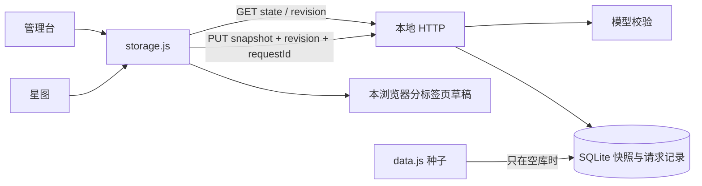

# MyNet 开发设计与实现说明

日期：2026-11-02。当前版本：0.1.1。本文解释审核修复后的实际设计。[审核状态](../DEVELOPMENT_REVIEW.md)、[修复记录](reviews/FIX_REVIEW_2026-11-02.md)、[当前代码摘要](CODE_BASELINE.json) 为配套材料。0.1.0 原实现说明与摘要保留在 reviews 目录，不能用其测试结论替代本版检测。

## 1. 使用范围与架构

当前是独立、本机、个人使用的 Node.js 24+ 与 SQLite 应用，不包含 Cloudflare 绑定、远程身份认证或主站集成。没有第三方运行依赖，不需要前端构建。浏览器自动化验收另外需要 Playwright 与可用 Chromium。

[REQUIREMENTS](../REQUIREMENTS.md) 是业务规则基线，[DESIGN](DESIGN.md) 保留 Canvas 原型的视觉和交互。本版不改变四星域初始内容，不新增跨星域参照、降格、回收站或排期规则。

| 层 | 文件 | 职责 |
| --- | --- | --- |
| 界面 | manage.html | 结构树、搜索表格、字段编辑、隶属移动、升格与关联 |
| 图形 | starmap.html | 总览、焦点图、距离计算、力导向布局和相机 |
| 存储适配 | storage.js | 异步启动、缓存、串行提交、幂等重试、草稿、导入与版本轮询 |
| 服务 | server.mjs | HTTP、访问边界、SQLite 事务、快照与幂等记录 |
| 模型 | lib/model.mjs | 全量快照的字段、结构、模板与关系校验 |
| 种子 | data.js | 初始内容、功能简述、配色和 file 模式的旧存储接口 |
| 工具 | tools/restore-data.mjs | 经校验和版本比较恢复 JSON 备份 |
| 检测 | tests/app.test.mjs、tests/regression.browser.mjs | 模型/接口/恢复/升级检测与审核问题的浏览器回归 |



## 2. 内容模型与规则

星域固定为 skill、idea、res、proj，保存 `name/short/en/focus/labels/relColors/elements/relations`。星域不是隶属父对象；星系由每个根及其唯一隶属后代推导，名称取根名称。

要素字段为 `id/name/parent/state/fn/desc`。根 parent 为 null，非根只有一个父节点。属性 state 为 attr，节点为 node。要素 ID 在星域内唯一；升格只改 state，不改身份、名称、父级和原有关联。新对象 ID 仍由原型的时间片段加随机片段生成，碰撞由校验拒绝，未实现自动重试。

关系字段为 `id/from/type/to`。两端必须在本星域，起点可以是属性，目标必须为节点。相同三元组不重复；不同类型可共存。引用允许回祖先、跨星系及形成业务环，隶属不允许环。

管理台添加下级时先升格父级，创建关联时先升格目标；起点不因此升格。服务器不执行自动升格命令，而是拒绝目标仍为属性的快照。升格和新增对象/关联一起保存，事务不会留下中间状态。升格提示注明等待保存，失败时明确说明未生效。

管理台移动前排除自身与后代，再检查一次，子树随 parent 路径移动。根并入另一星系时提示重组。删除仅允许没有下级或关联的要素。API 仍是可信本机的全快照接口，只保证最终结构；它可以执行界面未提供的整树删除或合法最终状态的降格。远程环境必须另设计操作授权。

## 3. 图形与距离

Canvas 2D、原型布局和视觉继续沿用。总览展示星域和星系，焦点图按当前节点与 R=1—5 展开。两个无焦点总览是 DESIGN 已有决定，需求中必须有焦点的交互在当前版本落实于焦点模式；最终产品是否保留总览仍可复核。

`recompute()` 为所有节点建无向邻接集合：隶属边计一跳，业务边计一跳，属性起点折算为所属节点。BFS 求最短距离，纳入距离 ≤R 的节点及其零距离属性；显示已展示对象间的已有关系，箭头保留业务方向。升格后原属性成为独立子节点，隶属距离由零变一。

星团采用 600 轮互斥与关联拉近，每星系最多 1500 星尘；焦点采用力导向、距离环和冷却。布局包含随机性且不写数据库。BFS 仍遍历可达图再筛选，队列使用数组 shift；大图性能尚未压测。

两页 URL hash 传递星域、选择和查询等上下文。管理台监听 hashchange 重读参数，有草稿时阻止自动切换并提示；星图在 hashchange 时重新载入，保留既有初始化过程。内部 replaceState 不触发这次重载。

## 4. 数据库与升级

默认 `.local/mynet.sqlite`，可通过 MYNET_DB 指定另一文件。相对配置按进程当前目录解析。使用 WAL 和 5000 ms busy timeout。

```sql
CREATE TABLE snapshots (
  revision INTEGER PRIMARY KEY,
  data TEXT NOT NULL,
  created_at TEXT NOT NULL DEFAULT (strftime('%Y-%m-%dT%H:%M:%fZ','now'))
);
CREATE TABLE requests (
  id TEXT PRIMARY KEY,
  digest TEXT NOT NULL,
  revision INTEGER NOT NULL
);
```

snapshots 每行是一份完整四星域 JSON，没有规范化要素表或外键。requests 保存请求 ID、请求内容 SHA-256 与成功版本，用于确认重复请求。SQLite `user_version=1` 标识当前 schema。

对已有、user_version=0 的快照库，先执行 SQLite `VACUUM INTO` 生成同目录 `.before-v1-时间戳` 完整备份，再事务创建请求表及版本标记。新空库无需升级备份。已有更高 schema 版本会拒绝启动。建表、空库判定与种子插入使用 IMMEDIATE 事务；种子仅空库时插入。启动校验最新 JSON，不合规则停止并提示保留数据库，不自动抹掉损坏内容。

种子由 VM 执行仓库自带 data.js 取得；VM 只用于读取受信脚本导出，不是执行不可信代码的安全边界。种子更新不会自动合并已保存数据库。

默认保留最近 200 个版本；MYNET_HISTORY_LIMIT 可设为 2—10000。成功写入时，在同一事务删除过期快照和对应幂等记录。较旧请求 ID 超出保留窗口后不能保证幂等重放，但其旧 revision 会被拒绝。升级备份不自动清理；历史不是永久存档，也不是独立备份。

## 5. HTTP 契约

| 方法与路径 | 行为 |
| --- | --- |
| GET /api/state | 返回 revision、updatedAt、domains |
| GET /api/revision | 仅返回 revision、updatedAt，供轮询 |
| GET /api/export | 下载当前 state JSON，不含历史与界面偏好 |
| PUT /api/state | 接收 revision、domains、可选 requestId，返回新 revision；幂等重放还返回 replayed:true |

revision 必须为正安全整数。requestId 如提供须为 8—100 字符的字母、数字、下划线或连字符；前端用 crypto.randomUUID。保留可选形式供旧本地客户端使用，无请求 ID 的调用没有幂等重试保证。请求顶层和内容模型未知字段均被拒绝。

PUT 的 Content-Type 需以 application/json 开头，请求体限 8 MiB。JSON 语法、顶层形状和版本错误为 400，内容结构错误为 422，旧版本或请求 ID 内容不一致为 409，跨源/Host 不符为 403，超限 413，类型不符 415，其他服务异常 500，未匹配路由或方法 404。服务器请求和头部接收超时分别为 15 秒与 10 秒。

## 6. 校验规则与口径

| 对象 | 规则 |
| --- | --- |
| 星域 | 固定四键；严格允许字段；每域 ≤10000 要素、≤50000 关系 |
| 模板 | 名称 ≤100；简称/英文名 ≤30；labels 三项非空且 ≤50；不含尖括号或 ASCII 控制符 |
| 关系类型 | ≤100 项；类型名非空 ≤50，不含模板禁用字符与原型污染保留名称；颜色为六位十六进制字符串 |
| 要素 | 严格字段；ID 是字符串并符合小写标识正则，最长 100，域内唯一；状态仅 attr/node |
| 文本 | name 非空 ≤200；fn 是字符串 ≤40，允许新建时为空；desc 是字符串 ≤20000 |
| 隶属 | parent 只能 null 或非空字符串；父级须存在且为节点；属性须有父级；父链无环 |
| 焦点 | 非空星域 focus 须指向节点；保存适配器在删除默认焦点后自动选首个节点，无节点设 null |
| 关系 | 严格字段与字符串类型；ID 唯一；两端存在且不自连；目标为节点；类型存在；三元组不重复 |

服务端文本长度仍按 UTF-16 单元，初始数据校验的 fn 按码点，两者对部分字符的长度口径不同。初始数据还要求非空 fn 并扫描常见敏感信息；运行时没有敏感信息扫描，也不判断内容事实真假。数量上限是拒绝规则，不是性能承诺。

## 7. 原子提交、幂等与冲突

保存前校验完整数据，再 BEGIN IMMEDIATE。若 requestId 已存在且 digest 相同，返回原成功版本，不再插入；同 ID 不同内容返回 409。若是新请求，比较最新 revision，不符则回滚；符合则写 revision+1 的快照和请求记录、执行历史保留，最后 COMMIT。

digest 针对包含原 revision 和 domains 的 JSON 字符串计算，不包含 requestId。幂等判断在版本比较之前，因此服务器已提交而响应丢失时，原样重试仍能得到成功结果。请求表与快照在同一事务，不会出现只记录成功 ID 却未保存内容的正常提交。

全库共用版本号；不同星域的并发修改仍会冲突。没有字段自动合并、跨标签页操作重放或强制覆盖。API 允许匿名可信本机程序写入，不等于支持多用户协作。

## 8. 前端保存、表单与失败草稿

服务模式两页等待 MyNet.ready 读取数据库后启动。初始失败会显示重载按钮，不回退种子继续编辑。file 模式仍使用旧浏览器存储，不具有本节服务器保证。

字段 change 后使用 commit(false)：不重绘结构树或编辑器，不设置整页 inert，也不在成功后将 DATA 替换为较早快照。新输入框的焦点与未提交文字因此不受上一字段保存影响。结构操作在当前操作后渲染，保存完成不再次重绘。恢复初始数据期间仍临时 inert，但请求等待有上限。

每次 save 立即捕获深拷贝，页面内使用 Promise 队列按顺序提交。提交时使用最新已确认 revision；同一页面快速编辑不会因上一保存仍在进行而被直接拒绝。界面以待完成数汇总状态，全部成功才显示已保存。

每次请求使用 AbortSignal.timeout(8000)，网络异常最多以相同 body 和 requestId 重试一次；有明确 HTTP 错误时不重试。两次网络等待一般最多约 16 秒，后台标签页或系统调度可能影响精确时间。两次失败后不丢弃本次 DATA，不将界面回滚。

每标签页使用 sessionStorage 中的随机 tab ID，在 localStorage 的 `mynet.data.v3.draft.<tab>` 保存完整草稿、原 baseRevision 和时间。多标签页草稿分开；新标签页通常不会自动列出其他标签页草稿。成功保存最新捕获版本后删除本页草稿。浏览器存储失败时保留内存并提示立即导出。

冲突或网络失败提供“导出未保存草稿”“恢复草稿到编辑器”，刷新后可找回本页草稿。恢复沿用草稿原 baseRevision，不自动用最新版本覆盖别人内容；需要用户对照最新内容整理。存在草稿时刷新/关闭触发 beforeunload 提示。未失焦的表单文字尚未进入 DATA，仍应先失焦并检查保存状态；未实现逐键草稿捕获或自动差异合并。

草稿包含个人内容，未加密，保存在当前浏览器本机。若浏览器禁用存储或用户清理站点数据，本地草稿不能保证保留。两次请求均失去响应时，即使服务器可能已提交，草稿仍保留；应核对服务器当前数据后再决定恢复。

## 9. 一次性导入与同步

旧 `mynet.data.v3` 不自动覆盖数据库。读取同源旧 JSON 后计算 SHA-256，仅对没有相同迁移指纹的内容显示导入按钮；成功保存才写指纹。保留原旧键以免丢失原始记录，后续相同内容不再提示；旧键内容改变会被视为新一份候选。用户仍须确认全量替换并先备份。无法写入迁移标记的浏览器不保证跨刷新去重。

每 10 秒对可见且不在提交中的页面查询 /api/revision。发现外部更新时提示刷新，不覆盖缓存和表单；有失败草稿时优先保留草稿操作。轮询网络错误等待下次，不提供完整持续断线监控。原型 storage 监听还保留，但服务保存不再写旧键，主要同步是版本轮询。

## 10. 本地安全边界

只绑定 127.0.0.1，Host 必须等于实际监听端口的 `127.0.0.1:port`；有 Origin 时要求完全同源，不开放 CORS。没有远程账户、TLS、用户隔离与 API token；无 Origin 的本机程序可以读写。不能直接改监听地址公开部署。

静态白名单只下发两页、data.js、storage.js，不下发数据库或其他源码。响应有 no-store、nosniff、DENY 与 no-referrer。模板进入 HTML 的 en/short 等字段已补 esc()，工具消息采用 textContent/createTextNode。新写入模板还拒绝 HTML 尖括号。

HTML 响应新增 CSP：脚本仅 self 与当前页内嵌脚本的 SHA-256，禁止任意内联事件脚本；哈希按 HTML 换行规范化计算。默认资源限 self，禁止 object、外部 base 与嵌入；样式仍允许内联以兼容原型，Google Fonts 样式与字体域明确放行，图片允许 data/blob。该策略是额外防御，不替代内容转义。

## 11. 备份、恢复与运行配置

导出只包括当前快照及版本/时间。恢复 CLI 校验 domains，读取当前版本，经 PUT 写新版本；指定端口可访问另一本机实例。错误捕获为“恢复失败”消息及退出码 1，不输出堆栈。CLI 读取/提交有 8 秒超时；超时结果不明时应先检查数据库，不应直接再次覆盖。

恢复初始内容或 JSON 都是普通快照写入，之前内容仅在历史保留窗口内可取。完整文件备份先停止服务再复制数据库目录；运行中不能只复制主文件遗漏 WAL。版本 0 升级备份使用 SQLite 一致性复制，不依赖直接复制运行中主文件。

PORT 默认为 8765，支持 0 供测试随机分配；MYNET_DB 配置库路径；MYNET_HISTORY_LIMIT 默认为 200。schema 版本高于程序会停止。没有自动启动守护、远程服务部署或快照压缩。

## 12. 检测与仍有边界

`npm test` 使用临时库：模型、非法输入、版本冲突、幂等、轻量版本查询、持久化、静态边界、失败原子性、恢复 CLI、保留数量和旧库升级备份。`npm run check:data` 检查初始内容。

`npm run test:browser` 是仓库内可复现脚本，使用临时服务、临时库和隔离 Chromium，阻断外部资源请求。需要另有 Playwright 模块和浏览器；可用 MYNET_PLAYWRIGHT_MODULE 指向已有模块入口、MYNET_CHROME 指向 Chrome。自动化回归范围对应 F1/F2/F3/F4/F5/F7/F10，具体结果以修复记录为准。

仍未覆盖手机、Firefox/Safari、触屏、所有 AC01—AC18 逐条浏览器验收、大规模性能、硬盘故障、损坏库完整恢复和多进程同时初始化压测。启动事务与最新数据校验改进了相关边界，不能据此声称故障恢复已完全验证。

本版没有 Cloudflare 集成。未来 D1、鉴权、多端访问、操作级授权、迁移与发布需独立设计，并遵守 RELEASE_REVIEW 与部署确认规则。当前修复通过不等于生产部署批准。
