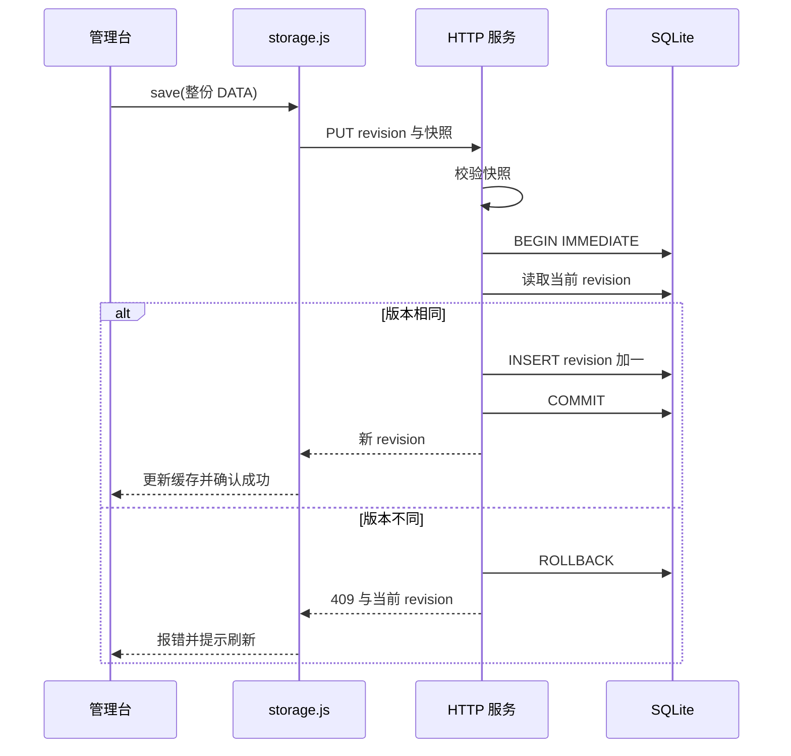

# MyNet 开发设计与实现说明

日期：2026-11-02。版本：0.1.0。本说明对应当前工作目录的实际代码，供开发与独立审核使用。代码文件摘要见 [代码基线](CODE_BASELINE_0.1.0.json)，审核入口见 [审核说明](DEVELOPMENT_REVIEW_0.1.0.md)。

当前实现是单机个人使用的 Node.js 与 SQLite 应用，保留原型的两页界面、Canvas 图形和四类模板。没有合并到 cloudflaremyapp，没有复制云端数据库，没有部署 Cloudflare。这里的设计解释不代表所有实现已达到生产发布要求；待处理问题单独列在审核说明中。

## 1. 需求与原型的关系

[REQUIREMENTS.md](../../REQUIREMENTS.md) 定义内容模型与 AC01—AC18；[DESIGN.md](../DESIGN.md) 保留原型的视觉、交互和布局决定。本轮主要将浏览器存储替换为本地数据库，同时保留原型流程。

| 需求 | 实现位置与行为 |
| --- | --- |
| 四个星域及独立模板 | `data.js` 的 `skill/idea/res/proj`；名称、节点名称、关系类型由模板提供 |
| 一个父节点决定结构 | 要素单个 `parent`；管理台移动操作与服务端隶属校验 |
| 星系由根节点命名 | 前端沿父链寻找根节点，不单独保存星系对象 |
| 属性是轻量节点 | 同一对象使用 `state: attr/node` 区分状态 |
| 扩展或成为关联目标时升格 | 管理台 `promote/opAddAttr/opAddChild/opAddRel` |
| 多关系、跨层、逆向引用 | 关系数组独立于隶属，允许业务关联环，不允许隶属环 |
| 焦点距离 | 星图 `recompute()`，属性关联起点折算到所属节点，节点间用无向邻接计算最短距离 |
| 双页面内容一致 | 两页先读取同一个 SQLite 最新快照，外部更新提示刷新 |

原型默认进入顶级总览，支持进入星域总览后再进入焦点星图。这是 DESIGN 已有的展示增强；需求中“每次必须有焦点”在当前实现中适用于焦点星图，两个总览没有焦点。审核时应确认是否接受该既有原型决定。

## 2. 技术与文件划分

运行要求为 Node.js 24 及以上，直接使用原生 HTTP、文件 API、VM 与 `node:sqlite`，没有 npm 第三方运行依赖和前端构建流程。选择 SQLite 是为了独立本地运行、事务保存和后续迁移，不需要为本地开发操作已有云数据库。

| 文件 | 职责 |
| --- | --- |
| `server.mjs` | 启动数据库、初始化种子、HTTP 路由、写事务、版本比较、静态白名单 |
| `lib/model.mjs` | 对整份星域数据执行服务端校验 |
| `storage.js` | 将 `MyNet` 读写接口接到 HTTP，管理缓存、版本、错误与旧数据导入 |
| `data.js` | 既有初始数据、FN 功能简述、原浏览器存储接口与配色 |
| `manage.html` | 结构树、搜索表格、编辑器与所有结构编辑操作 |
| `starmap.html` | Canvas 星图、图布局、相机、交互、距离计算与详情 |
| `tools/validate-data.mjs` | 初始数据质量校验和清单/快照生成 |
| `tools/restore-data.mjs` | 校验导出的备份，再经 HTTP 恢复为新版本 |
| `tests/app.test.mjs` | 模型与本地接口自动化检测 |

前端业务逻辑仍内嵌于两个 HTML，并未抽成组件或共享图模型模块。这样保留原型行为，但以后修改核心规则时要同时检查前后端。

```mermaid
flowchart LR
  seed[data.js 初始内容] -->|仅空库初始化| server[Node HTTP 服务]
  manager[manage.html 管理台] --> adapter[storage.js 缓存与版本]
  graph[starmap.html 星图] --> adapter
  adapter -->|GET / PUT state| server
  server --> validator[model.mjs 结构校验]
  server -->|快照事务| db[(SQLite snapshots)]
  server -->|白名单静态文件| manager
  server -->|白名单静态文件| graph
```

## 3. 内容对象与标识

一个星域保存 `name/short/en/focus/labels/relColors/elements/relations`。星域键固定为四种，不开放增加方向。`focus` 是星域默认焦点，页面实际焦点还可以由 URL 和交互改变。

要素结构：

```json
{"id":"example","name":"示例","parent":null,"state":"node","fn":"说明用途","desc":"补充细节"}
```

`id` 是同一星域内稳定身份；`parent` 是唯一隶属，根为 `null`；属性必须依附节点。`fn` 表达功能，`desc` 表达状态、经历和约束。新增对象使用 `MyNet.uid()` 的时间片段加随机片段，不是数据库分配 ID；碰撞会在服务端被拒绝，目前没有自动重试。

关系结构：

```json
{"id":"example_relation","from":"source","type":"帮助","to":"target"}
```

两端必须在同一星域，起点可为属性或节点，目标必须为节点。`from/type/to` 三元组不能重复，不同关系类型可以共存。关系不改变 `parent`。

初始数据加载会补齐关系 ID 和缺少的 FN。星图内部为了绘制会将关系映射为临时的 `r0/r1…`，该临时标识不写回数据库，数据库仍保存稳定关系 ID。

## 4. 隶属与升格的执行位置

管理台在移动下拉框中排除自身与后代，提交操作再检查一次；移动只改原对象 `parent`，子树通过父链自然跟随。父级是属性时先升格；属性设为根时也先升格。根并入其他根的后代时提示星系重组。

升格只将原对象 `state` 改为 `node`，不复制内容，不生成新 ID，不改父级和已有关系。添加下级时升格父对象；建立关系时升格目标，起点仍可保持属性状态。升格、添加下级或关系作为同一份快照提交，数据库不会保存中间步骤。

服务器不提供 `promote` 等独立命令，也不会自动修正关系目标，而是拒绝“目标仍为属性”的快照。因此自动升格是前端行为，服务端保障保存结果满足目标约束。

管理台只允许删除没有下级、没有入向或出向关系的对象。服务端当前只验证提交后的整体结构，不比较前后状态，所以直接调用 API 可以删除完整子树或同时删除关系，也可以将无下级且无入向关系的节点改成属性。这比管理台允许的操作更宽，审核时需要区分。

## 5. 焦点距离与图形渲染

`starmap.html` 使用 Canvas 2D，沿用原型的恒星、行星、卫星、星尘、轨道、箭头及相机过渡。详细视觉参数见 DESIGN 第 5 节。

距离计算流程如下：

1. 取本星域所有 `node` 对象，建立邻接集合。
2. 节点与父节点连接，作为一条无向距离边。
3. 每条业务关系将属性起点折算为其所属节点，连接到目标节点，作为一条无向距离边；箭头绘制仍保留业务方向。
4. 从当前焦点执行 BFS，首次到达的距离就是最短距离。
5. 纳入距离不大于 R 的节点及其属性，显示这些节点间已有隶属和关联。
6. 在范围边界统计未展示的相邻节点数量。

R 限制为 1—5。属性与所属节点零距离；升格后成为独立子节点，其隶属距离变为 1。隶属树的深度不代替关系距离。多个关联路径只显示一个节点。当前 BFS 遍历可达图后再按范围筛选，未实现按 R 提前截断；队列使用数组 `shift()`，大规模图性能尚未验证。

星团布局执行 600 轮互斥与关联拉近，星尘每星系最多 1500 粒；焦点布局使用力导向、距离环和冷却。布局与粒子包含随机性，没有将位置写入数据库。两页间通过 URL hash 携带星域、选中对象、焦点、范围或查询。界面偏好仍单独保存在浏览器中。

## 6. SQLite 设计与生命周期

默认文件为 `.local/mynet.sqlite`；`MYNET_DB` 可改为另一独立路径。相对路径按启动进程当前目录解析。创建目录后打开数据库，设置 WAL 与 5000 ms busy timeout。

```sql
CREATE TABLE IF NOT EXISTS snapshots (
  revision INTEGER PRIMARY KEY,
  data TEXT NOT NULL,
  created_at TEXT NOT NULL DEFAULT (strftime('%Y-%m-%dT%H:%M:%fZ','now'))
);
```

每行是一份包含四星域的完整 JSON；没有独立要素表、关系表或外键。最新数据取 revision 最大的一行，历史行保持保留。完整快照使整次修改具备原子性，也使结构不需要在多个关系表间同步，但每次修改和轮询都涉及整份数据，历史空间会随保存次数增长。

启动时在 VM 中执行仓库自带 `data.js`，取得并校验默认数据。仅当快照表为空时插入 revision 1；已有数据库不会被新版种子覆盖。VM 在此用于取得既有脚本导出，不作为运行不可信代码的安全沙箱。

没有数据库 schema 版本表、迁移脚本、自动修复、定期清理和压缩策略；现阶段只使用上述建表初始化。既有数据库最新内容读取时不重新执行 `validate()`，人工损坏数据库后的恢复需要另行处理。多实例同时对空库初始化的竞争尚未覆盖。

## 7. HTTP 接口契约

所有响应设置 `Cache-Control: no-store`、`X-Content-Type-Options: nosniff`、`X-Frame-Options: DENY`、`Referrer-Policy: no-referrer`。

| 方法与路径 | 输入 | 成功输出 |
| --- | --- | --- |
| `GET /api/state` | 无 | `revision/updatedAt/domains` |
| `PUT /api/state` | JSON：`revision/domains` | `{"revision":新版本}` |
| `GET /api/export` | 无 | 与 state 相同，附下载文件名 `mynet-backup.json` |

PUT 只接受以 `application/json` 开头的 Content-Type，请求体上限为 8 × 1024 × 1024 字节。先读取和解析请求，再校验内容；不支持局部更新、批量命令、搜索接口或历史查询接口。前端搜索在内存完成。

| 状态 | 当前使用场景 |
| --- | --- |
| 200 | 成功读取、保存或静态页面返回 |
| 400 | JSON 语法错误 |
| 403 | Host 不符或请求 Origin 不符 |
| 404 | 未匹配到明确路由，包括不支持的方法 |
| 409 | 版本与数据库当前最新版本不符 |
| 413 | 请求体超出限制 |
| 415 | PUT Content-Type 不符合要求 |
| 422 | 校验器主动报告的结构错误 |
| 500 | 未分类异常，返回通用服务错误 |

例如 JSON 顶层为 `null` 时访问 `body.domains` 会进入 500，而不是专门的 400/422。revision 没有独立类型和范围校验，直接用严格相等比较；无效版本通常进入 409。客户端不应据此假定所有非法请求都有细分的错误码。

## 8. 服务端校验清单

| 校验项 | 实际规则 |
| --- | --- |
| 星域集合 | 恰好四个固定键 |
| 数量 | 每星域最多 10000 要素、50000 关系，仍同时受总请求体限制 |
| 模板 | name ≤100、short/en ≤30，labels 三项 ≤50 且非空 |
| 关系颜色 | 最多 100 类型，类型名非空且 ≤50，颜色为六位十六进制 |
| 要素 ID | 正则 `^[a-z][a-z0-9_]{0,99}$`，星域内不重复 |
| 文字 | name 非空且 ≤200；fn 为字符串且 ≤40；desc 为字符串且 ≤20000 |
| 状态 | `node` 或 `attr` |
| 隶属 | parent 是字符串或 null；有父级时须存在且为节点；属性须有父级；父链不得成环 |
| 焦点 | 非空星域的 focus 须指向节点 |
| 关系 | 关系 ID 同格式且不重复；两端存在；目标是节点；不得自连；类型在模板；三元组不重复 |

字符串长度使用 JavaScript `.length`，按 UTF-16 单元计数。初始数据脚本对 fn 使用 Unicode 码点数量，两处长度口径略有不同。运行时允许空 fn，支持“先创建，再填功能”的现有编辑流程；初始数据校验要求每项都有非空功能简述。

当前运行时校验没有严格拒绝未知字段，也不执行初始数据脚本中的敏感信息扫描，不会判断事实真实性。`parent: ''` 对节点会因真值判断而被视为无父级，虽然文档约定根应为 null；关系类型字段及某些模板对象的类型检查也不是完整 JSON Schema。后续应规范化空父级并补充畸形对象测试。

## 9. 保存事务与冲突处理



比较的是整个数据库版本。即便两页修改不同星域，也会冲突；没有字段合并、操作重放或分星域版本。写事务内再次读取最新版本，避免“先读取再写入”之间被其他连接抢先更新。

`storage.js` 保存前深拷贝并修正失效的默认焦点为该星域首个节点，无节点则设 null。请求成功才更新本页缓存和 revision。管理台 `commit()` 在保存期间设置 `document.body.inert` 并显示“正在保存”；成功后读取缓存、重渲染并显示“已保存”。失败后将 DATA 回退为本页上次成功缓存，显示错误。因此失败的编辑不会保留为待重试草稿。

网络丢失可能发生在服务器已 COMMIT、客户端未收到响应之后。当前没有幂等请求 ID 或提交结果查询，页面可能提示失败而数据库已经保存，需刷新核实。fetch 没有应用级超时；请求挂起时 body 可能持续 inert。该问题必须在扩大使用范围前处理。

## 10. 启动、同步与旧数据

两页依次加载 `data.js`、`storage.js`，在异步函数中等待 `MyNet.ready` 后才启动界面。服务模式的 load 返回内存快照深拷贝。初次 GET 失败时显示重载按钮，不退回种子数据继续编辑，以免把读失败误当空库。

`file:` 模式保留原来的浏览器本地存储行为，不使用服务器；通过 Python 静态服务器打开则没有 `/api/state`，不是当前服务模式的启动方式。

加载后每 10 秒轮询完整 state，页面隐藏或正在保存时跳过。发现版本不同仅显示刷新按钮，不替换当前缓存，以免直接覆盖当前表单。失败轮询会静默等待下一轮，未提供持续断线状态。原型的 storage 事件监听仍存在，但服务模式保存不再写旧存储键，主要同步机制是轮询。

管理台在发现当前同源浏览器的旧存储键时，提供导入提示。用户确认后，将旧数据全量保存成新数据库版本；不是逐条合并。旧存储仍保留，导入后重载可能再次出现旧数据提示，目前没有一次性迁移标识。更换协议、主机或端口会切换浏览器存储空间，可能无法自动发现旧数据。

## 11. 备份与恢复

导出只包含当前快照、版本与更新时间，不包含历史快照、浏览器界面偏好或其他数据库文件。导出数据可能包含后续用户输入的私人内容，应由用户自行保管；它不是加密备份。

恢复命令为 `node tools/restore-data.mjs <备份.json> [本地端口]`。脚本读取 `backup.domains`，执行模型校验，再读取服务当前 revision，最后 PUT。备份自带旧 revision 不会直接用于覆盖比较。若读取后另有保存，恢复会收到 409，不能强行覆盖。

恢复通过普通写入创建新快照，保留恢复前的行。恢复初始数据也是普通快照写入。没有图形化历史恢复界面；需要某个历史版本时，可离线从快照表读取该行，包装为带 domains 的 JSON，再使用恢复脚本。当前恢复脚本没有交互确认，执行命令即表示替换当前内容。

完整文件备份先停止服务，再复制 `.local` 目录；运行期间不得仅复制主文件而忽略 WAL。历史快照与当前数据处于同一磁盘，不能替代独立备份。

## 12. 本地访问边界

服务仅绑定 `127.0.0.1`；Host 必须匹配 `127.0.0.1:数字端口`。Origin 存在时必须与 Host 构成的 HTTP origin 完全相同，不开放 CORS。`localhost` 和局域网地址不在当前允许访问方式内；Host 只检查格式，没有与实际监听端口再次对照。

静态路径只允许 `/`、两页 HTML、`data.js` 和 `storage.js`。数据库、源码、文档与任意文件路径不对外提供。初始 `data.js` 自身属于浏览器资源，文件中的种子数据会下发给本机浏览器。

没有登录、会话、用户隔离、TLS、API token 或数据加密。无 Origin 的本机程序可直接调用 API。现有边界只适合可信本机环境，不能直接更改监听地址后当作公开服务。

UI 大量使用模板字符串和 innerHTML；部分普通内容已经过 `esc()`，但模板元数据存在未统一转义的输出点（例如星图星域按钮中的 `d.en/d.short`、管理台模板标签）。API 允许保存模板字段，所以结构校验不等同于 HTML 安全，存在持久化 HTML 注入的风险，应作为审核重点。

Google Fonts 是原型保留的外部字体请求，断网回退系统字体。浏览器测试阻断了外部请求，不代表真实运行不会请求外部字体。没有新增统计或遥测，也没有配置 CSP。

## 13. 测试证据与缺口

自动化入口：`npm test`；初始数据入口：`npm run check:data`。测试使用临时数据库、随机回环端口，结束后删除临时文件，不触碰默认个人数据库。

当前三个 test case 检查模型约束、属性起点保持状态、目标需先升格、多类型关联、重复关系、跨域目标、数据库写入、旧版本冲突、非法快照失败原子性、跨 Origin 拒绝、静态文件白名单、备份内容及重启持久化。第二项测试名称虽提到“非法模板”，实际没有独立的非法模板断言，不能按名称推定覆盖。

上一轮隔离 Chromium 验收使用实际 HTTP 服务和临时数据库，检查英语详情编辑、刷新保留、添加属性、对属性添加下级自动升格、焦点星图及页面 JavaScript 异常。脚本和截图位于会话审核工件目录，未纳入仓库。仓库内 `npm test` 不能复现这部分浏览器验收；可复核步骤见根目录审核说明。

尚未完整自动化 AC01—AC18、关系目标自动升格的浏览器操作、焦点距离样例、旧数据导入、恢复 CLI、冲突页面交互、网络超时、提交后断线、手机与其他浏览器、空星域、深树、大图、故障磁盘及异常数据库恢复。初始内容当前为 49 星系、262 要素、58 关系；这不是容量或性能承诺。

## 14. 后续变更约束

本次没有改变用户已确认的四类模板语义与真实初始内容。以后修改内容规则时，应同时更新 REQUIREMENTS、DESIGN、运行时校验、管理台操作与验收用例；不能只改前端提示。

尚未进行 Cloudflare 适配。未来若迁移 D1，需要重新设计绑定、数据库迁移、鉴权与部署环境；当前 Node `DatabaseSync` 不能直接作为 Workers 部署实现。任何正式发布前均须准备根目录 `RELEASE_REVIEW.md` 并执行用户规定的部署确认，本审核文档不构成部署许可。
